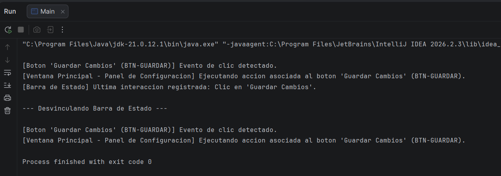

- Diseño de Software - Módulo 4
- Ejercitación 4.E.2 - Patrón Observer
Ejercicio 1: Notificador de Clic en Botón de Interfaz
Contexto del problema:
Una librería gráfica minimalista necesita que un botón interactivo informe de manera automática a una función de la ventana principal cuando el usuario hace clic sobre él, sin que el botón deba conocer los detalles internos de la ventana.

Objetivo de aprendizaje:
Comprender la estructura básica y el propósito fundamental del patrón Observer mediante la relación de uno a muchos entre un sujeto observable y sus observadores dependientes.

Requisitos funcionales:

Permitir registrar funciones o manejadores de eventos interesados en las acciones de pulsación del botón.

Notificar de forma automática a todos los oyentes suscritos cada vez que se simule un evento de clic sobre el componente gráfico.

Restricciones técnicas:

El sujeto observable (Botón) debe mantener una colección interna genérica de observadores sin acoplarse a implementaciones concretas de ventanas.

Los observadores deben implementar una interfaz o contrato común que declare el método de recepción del evento de clic.
***
# Lógica y Funcionamiento del Programa:
Para resolver este ejercicio apliqué el patrón Observer para desacoplar el componente visual Boton de los manejadores de eventos de la interfaz gráfica, permitiendo suscribir múltiples receptores sin que el botón conozca su implementación interna.

- Interfaz Observador: Define el contrato común actualizar(String idBoton, String etiquetaBoton) que deben implementar todos los manejadores que reaccionan ante una pulsación.

- Interfaz SujetoObservable: Establece los métodos registrarObservador(), eliminarObservador() y notificarObservadores() para administrar la lista de oyentes.

- Clase Boton: Implementa SujetoObservable y guarda sus suscriptores en una colección genérica List<Observador>. Al invocar hacerClic(), registra el evento y recorre la lista notificando automáticamente a todos los observadores suscritos sin depender de ninguna ventana concreta.

- Clases VentanaPrincipal y BarraEstado: Son los observadores concretos. Ambos implementan Observador y responden de forma independiente cada vez que reciben la notificación de clic desde el botón.

- Clase Main: En la prueba suscribí la ventana principal y una barra de estado a un botón, simulé una pulsación para comprobar la notificación simultánea y luego desvinculé la barra de estado antes de simular un segundo clic.
***
# Ejecucion por consola
